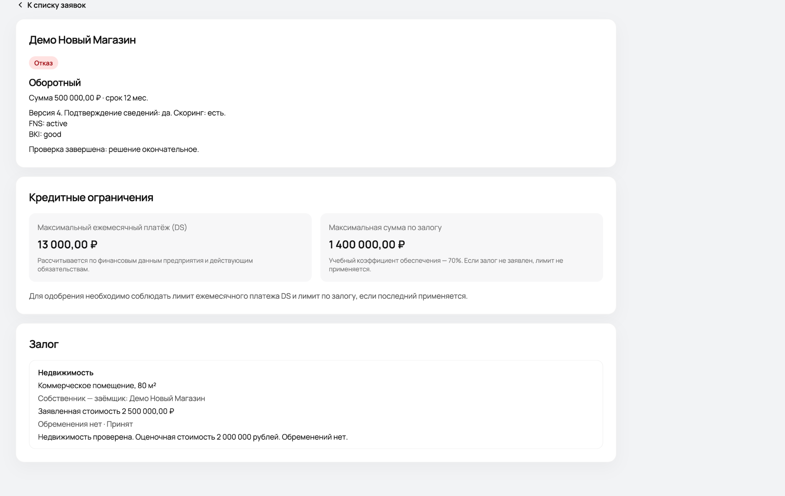

# Альфа.Навигатор — умный кредитный кабинет предпринимателя

> **MVP для хакатона «Альфа-Будущее», кейс «Умный кредитный кабинет предпринимателя».** Сквозной цифровой путь малого бизнеса и сотрудника банка: от выбора кредита и подачи заявки до решения, подтверждения договора и **симулированной** выдачи. Все клиенты, проверки и операции — синтетические. Проект не является официальным продуктом или кредитной методикой Альфа-Банка.

**Версия для проверки:** перед сдачей укажите точный commit SHA/tag именно той версии, которую будут запускать эксперты. `174b396` — исторический контрольный коммит тестового стенда, **не подтверждение актуальности последних локальных исправлений** (автомиграции, десять клиентов и прокси API).

[**Быстрый запуск**](#быстрый-запуск) · [**Сценарий для жюри**](docs/DEMO_GUIDE.md) · [**Архитектура**](docs/ARCHITECTURE.md) · [**API**](docs/API.md) · [**Тесты**](docs/TEST_SCENARIOS.md) · [**Дисклеймеры**](#границы-и-допущения-mvp)

## Зачем продукт нужен

Предпринимателю сложно сопоставить условия, рассчитать допустимый платёж, собрать сведения и понять статус заявки. Банковской стороне нужно собрать сведения в одном месте, выполнить проверки, оценить риск и объяснимо принять решение. **Альфа.Навигатор** связывает обе стороны в одном браузерном интерфейсе и сохраняет историю кредитного процесса.

**Ключевые преимущества MVP**

| Возможность | Польза предпринимателю | Польза банку |
| --- | --- | --- |
| Личный кабинет и два кредитных продукта | Прозрачный выбор суммы и срока | Единая структура заявок |
| Регистрация компании, ИНН, контакты | Нет повторного ввода данных компании | Привязка заявки к компании |
| Демо-проверки ФНС/БКИ и банковских операций | Понятный ход проверки | Единая модель проверок и аудита |
| Финансовый скоринг, банковская история и лимит DS | Реалистичная оценка платёжной нагрузки | Формальные правила оценки риска, при установленном банковском патче — учёт оборотов |
| Кредитные предложения или ручное рассмотрение | Альтернатива бинарному отказу | Контроль нестандартных случаев |
| Залог: объявленная и банковская оценка | Видно, как учитывается имущество | Лимит обеспечения и отметка обременений |
| Версионирование заявки и история событий | Видно текущий статус и изменения | Прослеживаемость решений |
| Шестизначный демонстрационный код и имитация выдачи | Конец процесса без внешних систем | Возможность проверить E2E-сценарий |

**Банковские операции:** в обновлённой версии предусмотрено использование истории поступлений и расходов при скоринге (правило `rules-v2-bank`). Эта функция доступна **только при применённом патче банковского скоринга и соответствующей миграции**; сам факт наличия операций в базе ещё не подтверждает, что они вошли в расчёт.

**Отдельно:** в клиентском кабинете есть **новостная лента**, выбирающая сообщения по отрасли компании (`frontend/src/features/news/catalog.ts`). Для новых компаний отрасль может быть `UNKNOWN`, поэтому для них отображаются общие новости; это известное ограничение, а не обещание полноценной персонализации.

**Пример реально проверенного экрана банкира:** лимит DS и ограничение по залогу.



**Схема взаимодействия сервисов:**


## Быстрый запуск

**Необходимое:** Docker Engine + Docker Compose v2, Git, свободные порты 5173/8000 (и 5432 при стандартной конфигурации). Сборка занимает время на скачивание базовых образов. Наличие дискретного GPU и установка LLM **не требуются**.

```bash
git clone https://github.com/Dimadge/Hacaton_2026.git
cd Hacaton_2026
cp .env.example .env
```

**Перед запуском откройте `.env` и задайте свои уникальные секреты** `POSTGRES_PASSWORD`, `DB_PASSWORD`, `JWT_SECRET` (не менее 32 байт), `DEMO_CLIENT_PASSWORD` и `DEMO_BANK_PASSWORD` (не менее 12 символов). `.env` не коммитится; `JWT_SECRET` и пароли из примеров не годятся для публичной эксплуатации.

```bash
docker compose up -d --build
docker compose ps -a
```

Открыть:
- **Веб-кабинет:** http://localhost:5173
- **Swagger/OpenAPI:** http://localhost:8000/docs
- **Проверка API:** http://localhost:8000/health
- **Проверка БД:** http://localhost:8000/ready

В обновлённой рабочей сборке контейнеры `db` и `api` должны иметь статус `healthy`, `frontend` — `Up`, а одноразовые `db-upgrade`, `db-role` и `demo-init` — успешно завершаться (`Exited (0)`). `demo-init` запускает `app/seed.py` автоматически: создаёт отсутствующие демоаккаунты и синхронизирует пароли **только известных тестовых учётных записей** с `.env`. Существующие связи пользователей с компаниями, заявки и банковские операции не должны перезаписываться. На публичном стенде синхронизация демопаролей при каждом запуске не рекомендуется.

> SQL из `db/init/001...009` PostgreSQL выполняет автоматически **только при первом создании пустого тома**. В обновлённой рабочей сборке `db-upgrade` отдельно проверяет существующую БД и применяет предусмотренные миграции без удаления тома. Для исходной версии без `docker-compose.override.yml` используйте [инструкцию по миграциям](docs/DEPLOYMENT.md). **`docker compose down -v` удаляет данные и для обновления запрещён.**

### Демонстрационные учётные записи

В обновлённой рабочей сборке после `docker compose up -d --build` автоматически подготавливаются следующие **синтетические** пользователи (в исходном `main` без локальных изменений — только пять первых клиентов и банкир, после отдельного `seed`):

| Роль | Email | Предназначение |
| --- | --- | --- |
| Клиент | `client_good@example.test` | Благоприятная проверка (`FNS: active`, `BKI: good`) |
| Клиент | `client_alternative@example.test` | Проверка альтернативных условий при высокой нагрузке |
| Клиент | `client_manual@example.test` | Ручное рассмотрение (`BKI: minor_delay`) |
| Клиент | `client_missing@example.test` | Уточнение недостающих сведений |
| Клиент | `client_reject@example.test` | Негативный сценарий (`BKI: critical`) |
| Клиент | `client_stable@example.test` | Демокомпания со стабильным профилем (`FNS: active`, `BKI: good`) |
| Клиент | `client_growth@example.test` | Демокомпания «Логистика» (`FNS: active`, `BKI: good`) |
| Клиент | `client_seasonal@example.test` | Демокомпания «Туризм» (`BKI: minor_delay`) |
| Клиент | `client_inactive@example.test` | Негативный результат проверки реестра (`FNS: inactive`) |
| Клиент | `client_unknown@example.test` | Неопределённые результаты проверок (`FNS/BKI: unknown`) |
| Банкир | `bank@example.test` | Очередь и решения по заявкам |

**Пароли:** у десяти тестовых клиентов — значение `DEMO_CLIENT_PASSWORD` из *локального* `.env`, у банкира — `DEMO_BANK_PASSWORD`. **В README не публикуются действующие пароли сервера.** В обновлённой рабочей сборке `demo-init` синхронизирует пароли указанных демоаккаунтов при каждом запуске. В исходном `main` пароль ранее созданного пользователя не меняется при повторном `seed`. Локальную автосинхронизацию тестовых паролей нельзя без дополнительной защиты использовать как режим эксплуатации публичного банка.

**Банковские данные:** обновлённый `seed.py` добавляет телефон, ФИО руководителя и, если у демокомпании ещё нет истории операций, демосчёт и до 36 операций за три завершённых месяца. Имеющиеся банковские операции и заявки не удаляются. Количество новых операций зависит от ранее заполненной базы.

Создание новых клиентов через форму регистрации тоже поддерживается. Mock ФНС/БКИ для новых компаний известен только при наличии ИНН в демонстрационном реестре `alfa.demo_external_profiles`; неизвестный ИНН не превращается автоматически в хорошую кредитную историю.

## Сценарий проверки за 10–15 минут

Основной тест удобнее выполнять **в веб-интерфейсе**; Swagger нужен лишь для диагностики. Подробные действия, альтернативы и ожидаемые статусы: **[docs/DEMO_GUIDE.md](docs/DEMO_GUIDE.md)**.

1. **Клиент:** войти под `client_good@example.test`, выбрать кредитный продукт, создать новую заявку, указать финансовые данные и отправить. `DRAFT → CHECKING`.
2. **Банкир:** войти под `bank@example.test`, найти заявку, посмотреть mock ФНС/БКИ, при установленном банковском патче — учёт истории операций в скоринге (`rules-v2-bank`), рассчитать скоринг и выполнить проверку. В зависимости от риска будет создан оффер или предложено ручное рассмотрение.
3. **При использовании залога:** клиент добавляет объект при редактировании черновика, банкир оценивает имущество прямо в интерфейсе. Для демонстрационного LTV 70% банковская оценка **2 000 000 ₽** соответствует пределу обеспеченной суммы **1 400 000 ₽**. Лимит DS по платежу действует независимо.
4. **Клиент:** для заявки со статусом `OFFERED` выбрать предложение (`ACCEPTED`), подтвердить договор шестизначным кодом (`SIGNED`) и запустить **симулированную** выдачу (`DISBURSED`).
5. **Отдельно:** показать кейсы `NEED_INFO`, `UNDER_REVIEW` и `REJECTED` — используйте демонстрационные клиентские профили и новые заявки. Не меняйте вручную итоговые статусы в БД.

**Важно о коде:** механизм выдачи демонстрационного кода работает только при `DEMO_SIGNING_CODE_VISIBLE=true` в локальном, изолированном демо-окружении. На публичном стенде он **отключён** и не заменяет настоящую доставку OTP. При `false` успешный сценарий можно пройти лишь до `ACCEPTED`; в документации это не скрывается.

## Тестирование

```bash
docker compose exec api python -m pytest -q
```

Для тестов демонстрационного подписания, если публичный инстанс держит выдачу кодов выключенной, разрешено включить режим **только в процессе pytest**:

```bash
docker compose exec -e DEMO_SIGNING_CODE_VISIBLE=true api python -m pytest -q
```

**Ранее зафиксированный результат на сервере НГТУ 25–26.10.2026:** `105 passed, 1 warning` (предупреждение совместимости Starlette/httpx); также получали HTTP 200 от `/health` и `/api/v1/products`. Результат относится к проверявшейся тогда версии и **не подтверждает автоматически работу последних изменений seed, автомиграций и прокси**. Для актуального коммита нужны повторные тесты и ручная проверка входа через браузер.

Тест-кейсы и негативные проверки: [docs/TEST_SCENARIOS.md](docs/TEST_SCENARIOS.md).

## Техническая документация

| Артефакт | Где искать |
| --- | --- |
| Архитектура, взаимодействие сервисов | [docs/ARCHITECTURE.md](docs/ARCHITECTURE.md), [SVG](docs/diagrams/architecture.svg) |
| API и эндпоинты | [docs/API.md](docs/API.md); интерактивный [Swagger](http://localhost:8000/docs) |
| Коллекция HTTP-запросов | [docs/api/Alfa_Navigator.postman_collection.json](docs/api/Alfa_Navigator.postman_collection.json) |
| Машина состояний заявки | [docs/STATE_MACHINE.md](docs/STATE_MACHINE.md) |
| Упрощённая модель данных | [docs/DATA_MODEL.md](docs/DATA_MODEL.md), [ER-схема](docs/diagrams/data-model.svg) |
| Пошаговый демо-сценарий | [docs/DEMO_GUIDE.md](docs/DEMO_GUIDE.md) |
| Проверки и результаты | [docs/TEST_SCENARIOS.md](docs/TEST_SCENARIOS.md) |
| Продуктовые гипотезы и эффект | [docs/PRODUCT_RESEARCH.md](docs/PRODUCT_RESEARCH.md) |
| Развёртывание и обновление | [docs/DEPLOYMENT.md](docs/DEPLOYMENT.md) |
| Лицензии и имитации интеграций | [THIRD_PARTY_NOTICES.md](THIRD_PARTY_NOTICES.md) |
| Финальная сдача и доступ жюри | [docs/SUBMISSION_CHECKLIST.md](docs/SUBMISSION_CHECKLIST.md) |

## Архитектура и ключевые файлы

- `frontend/` — React 19 + TypeScript + Vite; клиентский и банковский кабинеты, новости, формы.
- `app/main.py`, `app/api/v1/` — FastAPI, JWT-авторизация с ролями `CLIENT` / `BANK_EMPLOYEE`, Swagger.
- `app/services/` — жизненный цикл заявки, скоринг, кредитные решения, залоги, подписание.
- `app/scoring/` — детерминированные формулы и правила, предложения, объяснения; при установленном патче — `bank_history.py` и банковский фактор.
- `app/integrations/` — **mock**, а не реальные подключения к ФНС/БКИ.
- `app/seed.py` — в обновлённой версии 10 синтетических клиентов, банковский сотрудник и недостающие демооперации.
- `db/init/` — SQL-схема и дополнения (`001`–`009`); в обновлённой сборке `db/startup_migrate.sh` проверяет схему существующей базы, а `db/migrations/20261026_bank_scoring.sql` подключается при наличии банковского патча.
- `app/setup_role.py` — создание/настройка прикладной SQL-роли.
- `Dockerfile`, `docker-compose.yml`, `frontend/Dockerfile` — воспроизводимое развёртывание; `docker-compose.override.yml` в обновлённой сборке задаёт этапы `db-upgrade` и `demo-init`. `frontend/nginx.conf` направляет `/api/` к FastAPI **только после установки обновлённой конфигурации прокси**.

## Границы и допущения MVP

- **Не реальный банк:** тарифы, скоринговые правила, FNS/BKI, банковские операции, проверка залога, статус выдачи и новости демонстрационные.
- **Итог скоринга не равен вероятности одобрения:** оценка риска и банковское решение разделены. При неизвестных данных система запрашивает ручную обработку, а не ставит «хорошо» по умолчанию.
- **Залог:** демонстрационное правило LTV 70% — не норматив Альфа-Банка. Для заявки с залогом ограничивается обеспеченная сумма; платёжеспособность DS проверяется отдельно.
- **Подпись:** код, показанный в демо-интерфейсе, не является настоящим вторым фактором; для публичной системы нужен безопасный канал доставки и юридическая схема подписания.
- **Выдача:** `DISBURSED` — симуляция, реальный перевод средств не осуществляется.
- **LLM:** необязательная локальная модель через Ollama для объяснений, с детерминированным fallback; базовый кредитный путь работает без неё. Использование внешних платных API не требуется.
- **Безопасность:** только синтетические данные. Публичная эксплуатация с реальными данными требует HTTPS, изоляции секретов, ротации учётных данных, мониторинга и дополнительного аудита.

## Публикация для жюри

Хакатон требует **указать точный SHA коммита и предоставить читаемый/клонируемый репозиторий**. Если репозиторий приватный, пригласите GitHub-аккаунт `alfa-hack-2026` с правом чтения. Описание и результаты проверки должны быть доступны сразу из README; ссылка на публичный сервер — **дополнительный канал**, а не замена возможности собрать Docker локально.

**Репозиторий:** https://github.com/Dimadge/Hacaton_2026  
**Демо-стенд (HTTP, только тестовые данные):** http://217.71.129.139:6400 — доступность из внешней сети и работа авторизации через `/api/` требуют повторной проверки после установки серверного прокси; факт открытия страницы не означает доступность backend.  
**Последняя проверка перед отправкой:** `git rev-parse HEAD`, тесты, приватный доступ жюри и работающий сценарий.
