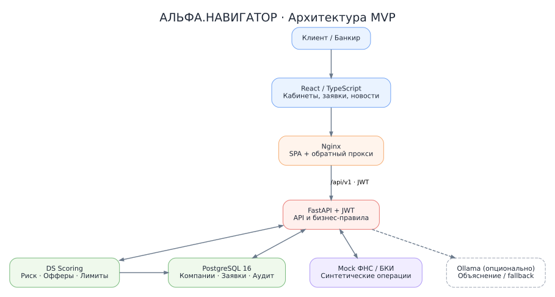

# Альфа.Навигатор — умный кредитный кабинет предпринимателя

Прототип цифрового кредитного конвейера для малого и микробизнеса: клиент выбирает продукт, подаёт заявку, получает решение, принимает предложение, если оно согласовано со стороны банка. Сотрудник банка рассматривает заявку в отдельном кабинете.

Все компании, банковские операции, проверки и условия кредитования — синтетические. Проект не является официальным продуктом или кредитной методикой Альфа-Банка. Реальные переводы и юридически значимая электронная подпись не выполняются.

[Быстрый запуск](#быстрый-запуск) · [Проверочный сценарий](#основной-сценарий-проверки) · [Архитектура](docs/ARCHITECTURE.md) · [API](docs/API.md) · [Ограничения](#известные-ограничения-текущей-версии)

## Версия и результаты проверки

Проверка этой кодовой базы:

- Backend: `python -m pytest -q` — **112 passed, 1 warning**. Предупреждение относится к использованию httpx в Starlette TestClient.
- Frontend: установка через `npm ci --ignore-scripts --no-audit --no-fund`, затем `npm run build` — успешная production-сборка Vite.
- Проверки выполнены отдельно от Docker. Полный запуск контейнеров, работа с настоящей PostgreSQL и сквозной браузерный сценарий этой проверкой не подтверждены. В тестах используются в том числе заглушки.

## Возможности

| Возможность | Реализация |
| --- | --- |
| Клиентский кабинет | Регистрация компании, вход, продукты, заявки и история событий |
| Банковский кабинет | Очередь заявок, проверки, скоринг, ручные решения |
| Проверки бизнеса | Локальные mock ФНС/БКИ, без внешних запросов |
| Скоринг | Финансовые показатели, долговая нагрузка, история бизнеса и банковские поступления |
| Кредитное решение | Одобрение, альтернативные условия, ручное рассмотрение, уточнение данных, отказ |
| Залог | Заявленная и банковская оценка, обременения, принятие/отклонение, ограничение суммы |
| Завершение процесса | Приём предложения, демонстрационный код подписания, симуляция выдачи |
| Согласованность | Версии заявок, проверка переходов, история событий |
| Новости | Локальный каталог с отбором по отрасли компании |

Регистрация требует email, пароль, название компании, ИНН, телефон и ФИО руководителя. Отдельного выбора отрасли в форме регистрации нет.

## Архитектура



- **Frontend:** React 19, TypeScript, Vite; собранный интерфейс обслуживается Nginx.
- **API:** Python 3.12, FastAPI, SQLAlchemy, psycopg; JWT и роли `CLIENT` / `BANK_EMPLOYEE`.
- **Данные:** PostgreSQL 16, SQL-инициализация и предусмотренные обновления схемы.
- **Решения:** детерминированные правила `rules-v2-bank`, ограничения продукта, платежа и залога.
- **Объяснения:** шаблоны; опционально локальная модель через Ollama. Основной процесс не требует LLM или платного API.

Браузер обращается к `/api/v1` на том же адресе, где открыт интерфейс. В Docker Nginx проксирует `/api/` в `api:8000`; при локальной разработке Vite проксирует `/api` на `127.0.0.1:8000`.

## Быстрый запуск

### 1. Требования

- Git.
- Docker Engine / Docker Desktop и Docker Compose v2.
- Свободные порты `5173`, `8000`, `5432` либо другие значения в `.env`.
- Доступ к реестрам образов и пакетов для первоначальной сборки.

Отдельно устанавливать PostgreSQL, Python, Node.js, GPU или Ollama для Docker-запуска не нужно.

### 2. Настройка

```bash
git clone https://github.com/Dimadge/Hacaton_2026.git
cd Hacaton_2026
cp .env.example .env
```

В PowerShell вместо `cp` можно использовать `Copy-Item .env.example .env`.

Задайте в `.env` собственные значения `POSTGRES_PASSWORD`, `DB_PASSWORD`, `JWT_SECRET`, `DEMO_CLIENT_PASSWORD`, `DEMO_BANK_PASSWORD`. JWT-секрет должен занимать не менее 32 байт UTF-8; оба демопароля — не менее 12 символов.

### 3. Запуск всех компонентов

Из корня проекта:

```bash
docker compose up -d --build
docker compose ps -a
```

Compose автоматически объединяет `docker-compose.yml` и `docker-compose.override.yml`. Второй файл нужен для предусмотренной цепочки обновления и автоматической подготовки демоданных. Запуск только с `-f docker-compose.yml` не эквивалентен этой инструкции.

| Сервис | Ожидаемое состояние |
| --- | --- |
| `db` | Работает, `healthy` |
| `db-upgrade` | Завершился, `Exited (0)` |
| `db-role` | Завершился, `Exited (0)` |
| `demo-init` | Завершился, `Exited (0)` |
| `api` | Работает, `healthy` |
| `frontend` | Работает |

Порядок подготовки: PostgreSQL → обновление схемы → прикладная SQL-роль → демоданные → API → интерфейс. Завершение одноразовых сервисов с кодом `0` нормально.

### 4. Адреса и диагностика

| Адрес | Назначение |
| --- | --- |
| http://localhost:5173 | Клиентский и банковский веб-кабинеты |
| http://localhost:8000/docs | Swagger |
| http://localhost:8000/openapi.json | OpenAPI |
| http://localhost:8000/health | Проверка API |
| http://localhost:8000/ready | Готовность подключения к БД |

```bash
curl -f http://localhost:8000/health
curl -f http://localhost:8000/ready
curl -f http://localhost:5173/api/v1/products
```

Последний запрос проверяет путь через Nginx фронтенда. При изменении портов используйте свои значения.

Логи при ошибке запуска:

```bash
docker compose logs --tail=150 db db-upgrade db-role demo-init api frontend
```

## Конфигурация

| Переменная | Назначение |
| --- | --- |
| `POSTGRES_DB`, `POSTGRES_USER`, `POSTGRES_PASSWORD` | База и административная учётная запись PostgreSQL |
| `DB_USER`, `DB_PASSWORD` | Прикладная SQL-роль API |
| `JWT_SECRET`, `JWT_EXPIRE_MINUTES` | Подпись JWT и срок действия, по умолчанию 120 минут |
| `DEMO_CLIENT_PASSWORD`, `DEMO_BANK_PASSWORD` | Пароли аккаунтов, обслуживаемых `app.seed` |
| `DEMO_SIGNING_CODE_VISIBLE` | Разрешение выдачи экранного демокода; по умолчанию `false` |
| `POSTGRES_PORT`, `API_PORT`, `FRONTEND_PORT` | Порты хоста; по умолчанию 5432, 8000, 5173 |
| `CORS_ORIGINS` | Разрешённые источники для API; по умолчанию `http://localhost:5173` |
| `DB_HOST`, `DB_PORT` | Для запуска вне Compose; внутри Compose подключение API настроено на `db:5432` |
| `VITE_API_URL` | Сохранилась в конфигурации сборки, но текущий `client.ts` использует `/api/v1` напрямую |
| `OLLAMA_BASE_URL`, `OLLAMA_MODEL` | Опциональные настройки объяснений; текущий Compose не передаёт их в API явно |

Наличие `OLLAMA_*` в корневом `.env` само по себе не настраивает API-контейнер. Для отдельной демонстрации LLM нужно передать эти переменные в его `environment` и обеспечить доступ к Ollama. В коде по умолчанию используются `http://host.docker.internal:11434` и `qwen2.5:latest`; при недоступности сервиса возвращается шаблон.

## Демонстрационные аккаунты и данные

`demo-init` автоматически запускает `app.seed`. При обычном запуске отдельная команда заполнения не требуется. Повторно запустить подготовку можно так:

```bash
docker compose run --rm seed
```

Seed синхронизирует пароли **перечисленных ниже** тестовых аккаунтов с `.env`, сохраняет существующие связи с компаниями и не удаляет заявки или операции. Существующие mock-профили не перезаписываются.

| Email | Использование / оговорка |
| --- | --- |
| `client_good@example.test` | Основной сценарий; исходный профиль `active/good` |
| `client_alternative@example.test` | Альтернативные условия при соответствующих параметрах заявки |
| `client_manual@example.test` | Ручное рассмотрение; исходный БКИ `minor_delay` |
| `client_missing@example.test` | Сценарий уточнения; результат зависит от полноты заявки |
| `client_reject@example.test` | Отказ; исходный БКИ `critical` |
| `client_stable@example.test` | Дополнительный клиент; привязка компании различается в SQL и seed |
| `client_growth@example.test` | Дополнительный клиент; привязка компании различается в SQL и seed |
| `client_seasonal@example.test` | Профиль SQL отличается от предлагаемого в seed; проверить сохранённые флаги |
| `client_inactive@example.test` | Имя аккаунта не гарантирует `inactive` в текущей сборке |
| `client_unknown@example.test` | Имя аккаунта не гарантирует `unknown` в текущей сборке |
| `bank@example.test` | Сотрудник банка |

Пароль этих клиентов — `DEMO_CLIENT_PASSWORD`, банкира — `DEMO_BANK_PASSWORD` из локального `.env`.

## Основной сценарий проверки

Используйте два браузера или отдельные профили: один для клиента, другой для банкира. Для каждого сценария создавайте новую заявку.

### 1. Клиент создаёт заявку

Войти под `client_good@example.test`, выбрать инвестиционный продукт и заполнить:

| Поле | Демонстрационное значение |
| --- | --- |
| Цель | Покупка оборудования |
| Сумма | 1 000 000 ₽ |
| Срок | 36 месяцев |
| Среднемесячная выручка | 1 500 000 ₽ |
| Операционные расходы | 900 000 ₽ |
| Текущие платежи по долгам | 50 000 ₽ |
| Возраст бизнеса | 36 месяцев |
| Резерв | 800 000 ₽ |
| Подтверждение сведений | Да |

Отправить заявку. Видимый статус меняется с `DRAFT` на `CHECKING`; промежуточный `SUBMITTED` проходит внутри подачи. ФНС/БКИ берутся из синтетического профиля.

Это стартовый набор для проверки, а не гарантия одобрения на произвольной базе: решение также зависит от сохранённых проверок, банковской истории и залога.

### 2. Сотрудник банка рассматривает заявку

Войти как `bank@example.test`, открыть заявку, проверить сведения и результаты ФНС/БКИ. Нажать «Рассчитать скоринг», затем «Проверка».

Проверить итоговый балл, риск, платёжный лимит, причины и банковский фактор. Возможны предложение (`OFFERED`), ручное рассмотрение (`UNDER_REVIEW`), уточнение (`NEED_INFO`) или отказ (`REJECTED`). Не менять статусы вручную в БД ради демонстрации.

### 3. Клиент завершает процесс

Для заявки в `OFFERED`:

1. Выбрать предложение → `ACCEPTED`.
2. При включённом `DEMO_SIGNING_CODE_VISIBLE=true` запросить код и ввести показанное значение → `SIGNED`.
3. Нажать «Получить средства» → `DISBURSED`.
4. Проверить историю, обновить страницу и убедиться, что результат сохранён.

Код действует пять минут, число неверных попыток ограничено. `DISBURSED` означает симуляцию без реального движения денежных средств.

На данный момент реализации `DEMO_SIGNING_CODE_VISIBLE` не работает. В дальнейших версиях данная функция будет реализованна.

Если настройка демокода изменена после запуска:

```bash
docker compose up -d --force-recreate api
```

### 4. Дополнительные проверки

| Сценарий | Действие и ожидаемый результат |
| --- | --- |
| Ручное рассмотрение | `client_manual`: полная заявка, проверка, `UNDER_REVIEW`, решение сотрудника |
| Уточнение | Банкир запрашивает сведения; клиент дополняет заявку и повторно отправляет: `NEED_INFO → CHECKING` |
| Отказ | `client_reject`: новая заявка с подтверждёнными сведениями, критическая БКИ, `REJECTED` |
| Залог | Клиент добавляет объект до подачи; банкир принимает оценку 2 млн ₽; демонстрационный предел 70% = 1,4 млн ₽, дополнительно действует платёжный лимит |
| Доступ | Клиент не может вызвать банковские действия или прочитать чужую заявку |
| Повторные действия | Повторная подпись/выдача не выполняется; устаревшая версия заявки отклоняется |
| Сохранность | После перезапуска контейнеров заявки и события остаются |
| Новости | Сравнить ленты компаний `MANUFACTURING` и `TRADE`; для `UNKNOWN` доступны общие материалы |

Подробный дополнительный сценарий: [docs/DEMO_GUIDE.md](docs/DEMO_GUIDE.md). Его примеры следует сопоставлять с оговорками об актуальных демоданных выше.

## Скоринг и банковская история

Интеграция уже находится в `main`; дополнительные патчи не требуются.

- `app/services/workflow.py` сохраняет снимок данных при подаче.
- `app/services/bank_turnover.py` агрегирует историю компании за последние три завершённых месяца UTC.
- `app/scoring/bank_history.py` рассчитывает банковский фактор.
- `app/scoring/__init__.py` объединяет базовую оценку и банковский фактор; `RULE_VERSION = rules-v2-bank`.
- `app/api/v1/bank.py` возвращает пофакторный анализ для банковского кабинета.

Для подтверждённой истории нужны записи покрытия по всем счетам за все три месяца. Оцениваются поступления `IN/SALES`; кредитные поступления и собственные переводы не подменяют продажи. В метриках отдельно собираются операционные расходы `OUT/OPERATING`.

При доступном банковском факторе итог складывается из 85% базового балла и 15% банковского. При неполной истории базовый балл сохраняется; отсутствие подтверждения не приравнивается к нулевому обороту. Скоринговый балл не является вероятностью одобрения. Кредитное решение отдельно учитывает проверки, параметры продукта, платёжеспособность и залог.

На дату 26.10.2026 расчётный период — июль–сентябрь 2026. При последующих запусках статическая история может перестать покрывать последние три месяца.

## Тестирование

После запуска:

```bash
docker compose exec api python -m pytest -q
```

Тесты BE-08 включают деморежим подписания внутри тестового процесса через `tests/conftest.py`; это не включает выдачу кода в работающем API.

Дополнительная локальная проверка фронтенда при установленном Node.js:

```bash
cd frontend
npm ci
npm run build
```

Успешная сборка Vite не заменяет отдельную проверку типов TypeScript или ручной E2E. Перед сдачей пройдите основной сценарий в браузере с реальной PostgreSQL и сохраните фактические результаты в [docs/TEST_SCENARIOS.md](docs/TEST_SCENARIOS.md).

## Обновление и сохранность данных

После получения проверенных изменений:

```bash
docker compose up -d --build
docker compose ps -a
```

`db/init/001...009` выполняются PostgreSQL автоматически только при создании пустого тома. На существующей базе `db-upgrade` проверяет предусмотренные объекты и применяет соответствующие SQL, включая `db/migrations/20261026_bank_scoring.sql` при отсутствии версии правил. Это конкретный скрипт обновления, а не универсальный механизм миграций произвольной старой схемы.

- Перед обновлением существующей базы сделайте резервную копию.
- Не используйте `docker compose down -v` для обновления: команда удаляет том PostgreSQL.
- `demo-init` повторно синхронизирует пароли известных ему демоаккаунтов.
- Повторное заполнение не исправляет автоматически расхождения существующих mock-профилей и не продлевает уже имеющуюся историю операций.

Подробности: [docs/DEPLOYMENT.md](docs/DEPLOYMENT.md).

## Документация

| Материал | Файл |
| --- | --- |
| Архитектура | [ARCHITECTURE.md](docs/ARCHITECTURE.md), [схема](docs/diagrams/architecture.svg) |
| API | [API.md](docs/API.md), `/docs`, `/openapi.json` работающего API |
| Postman | [Alfa_Navigator.postman_collection.json](docs/api/Alfa_Navigator.postman_collection.json) |
| Состояния заявки | [STATE_MACHINE.md](docs/STATE_MACHINE.md) |
| Модель данных | [DATA_MODEL.md](docs/DATA_MODEL.md), [ER-схема](docs/diagrams/data-model.svg) |
| Демо | [DEMO_GUIDE.md](docs/DEMO_GUIDE.md) |
| Проверки | [TEST_SCENARIOS.md](docs/TEST_SCENARIOS.md) |
| Продуктовые гипотезы | [PRODUCT_RESEARCH.md](docs/PRODUCT_RESEARCH.md) |
| Развёртывание | [DEPLOYMENT.md](docs/DEPLOYMENT.md) |
| Сторонние компоненты и имитации | [THIRD_PARTY_NOTICES.md](docs/THIRD_PARTY_NOTICES.md) |
| Сдача | [SUBMISSION_CHECKLIST.md](docs/SUBMISSION_CHECKLIST.md) |

## Известные ограничения текущей версии

1. **Демоданные:** SQL и seed расходятся по некоторым аккаунтам, ИНН и профилям. Нельзя гарантировать сценарий только по имени аккаунта.
2. **Подписание:** по умолчанию выдача экранного кода отключена; для полного демонстрационного пути нужна явная настройка.
3. **Объяснения:** шаблон в `app/scoring/explain.py` не выделяет отказ и запрос информации отдельными корректными ветками; текст может расходиться со статусом. В endpoint объяснения нулевой `max_new_payment` ошибочно трактуется как отсутствие расчёта. До исправления сверяйте статус и коды причин.
4. **Секреты:** `.env` отслеживается в проверенном коммите; требуется исключить его и заменить использованные опубликованные секреты.
5. **Зависимости:** frontend имеет lock-файл; Python-зависимости пока заданы диапазонами в `requirements.txt`. Полная фиксация проверенного Python-окружения ещё нужна.
6. **Даты операций:** существующая история не продлевается автоматически; доступность банковского фактора зависит от даты запуска.
7. **Новости:** небольшой статический каталог, новые компании с неизвестной отраслью видят общие материалы.
8. **LLM:** необязательная интеграция, модель не входит в стандартный Compose; проверяемая базовая версия работает с шаблонами.

Настоящие внешние проверки, юридически значимая подпись и реальные платежи находятся вне границ MVP. Нельзя загружать реальные клиентские данные на демонстрационный стенд.
