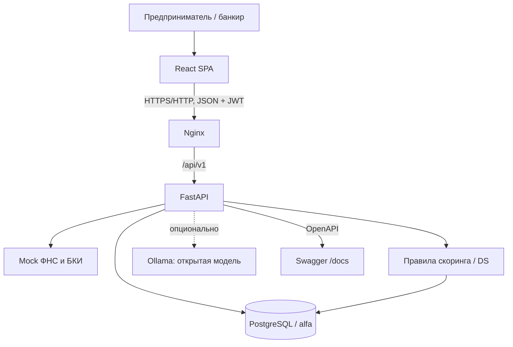

# Архитектура Альфа.Навигатора

## Сервисы и ответственность

1. **Frontend (React + TypeScript)** — единый веб-кабинет клиента/банкира. Клиент заполняет заявку, следит за статусами и выбирает оффер; банкир оценивает риски, залог и принимает решения.
2. **Nginx** — раздаёт собранный SPA; на тестовом сервере внешний Nginx отдельно перенаправляет `/api/` на FastAPI. В локальном Docker frontend работает на `localhost:5173`, API — на `localhost:8000`.
3. **FastAPI** — JWT-авторизация, роли, Pydantic DTO, HTTP-коды ошибок, API `/api/v1/...`, контракты OpenAPI в `/docs` и `/openapi.json`.
4. **PostgreSQL** — транзакции, связи, ограничения, аудит событий, immutable-снимки проверок/скоринга, версия заявки. Отдельная SQL-роль приложения создаётся `app/setup_role.py`.
5. **Scoring / decision policy** — правила риска, лимит ежемесячного платежа (DS), ограничения продукта, альтернативные предложения и ограничение принятой стоимости залога; результаты сохраняются, банковские решения ссылаются на актуальный запуск проверки.
6. **Mock-интеграции** — ФНС/БКИ, данные банковских операций, OTP/выдача; отсутствуют корпоративные и платные внешние зависимости.
7. **Ollama (необязательно)** — генерация объяснения решения при наличии локальной модели; при недоступности используется шаблонный fallback, основной E2E не блокируется.

## Передача данных

### Принципы

- **Данные в базе:** денежные величины `NUMERIC/Decimal`, в API передаются строками; числа с плавающей запятой не используются для денег.
- **Владение:** клиент читает только свою компанию и заявки, банковские операции доступны роли `BANK_EMPLOYEE`.
- **Согласованность:** связанные обновления внутри транзакций; заявка имеет `version` для защиты от устаревших действий.
- **История:** версии финансовых анкет и журнал `application_events` сохраняются; trigger-ограничения запрещают менять исторические записи.
- **Безопасность:** Argon2 для паролей; JWT; не публиковать `JWT_SECRET`, пароли PostgreSQL и реальные Bearer-токены.
- **Запуск:** `docker compose up -d --build`, начальная SQL-схема, seed; после первого запуска миграции нужно применять осознанно.

Связанные артефакты: [модель данных](DATA_MODEL.md) · [диаграмма статусов](STATE_MACHINE.md) · [API](API.md).
