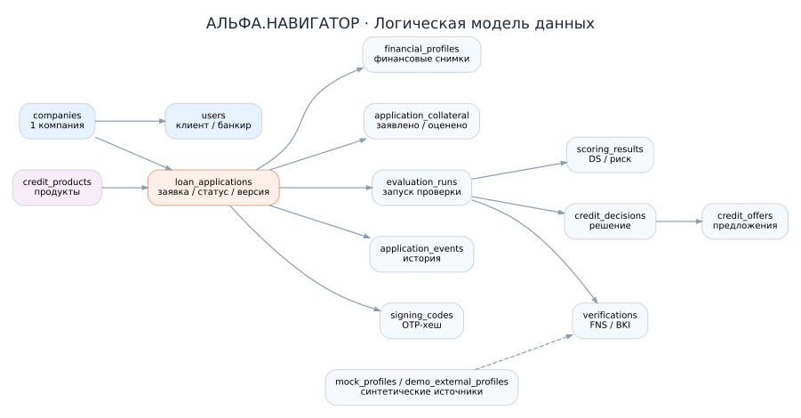

# Модель данных PostgreSQL

Основная схема: `alfa`. Источник истины — файлы `db/init/001...009*.sql` в репозитории.

## Группы таблиц

| Подсистема | Таблицы | Назначение |
| --- | --- | --- |
| Компании и пользователи | `companies`, `users` | ИНН, контакты, JWT-роли `CLIENT/BANK_EMPLOYEE` |
| Продукты | `credit_products`, `scoring_rules`, `reason_codes` | Продукты, версии правил, коды объяснений |
| Заявки | `loan_applications`, `financial_profiles`, `monthly_financials`, `application_documents` | Параметры заявки, версионирование финансов, документы |
| Проверки | `mock_profiles`, `demo_external_profiles`, `evaluation_runs`, `verifications` | Демо ФНС/БКИ, снимки этапа проверки |
| Риск и решения | `scoring_results`, `scoring_result_reasons`, `credit_decisions`, `decision_reasons`, `credit_offers` | Оценка, риск, объяснения, предложения |
| Финансовая история | `bank_accounts`, `bank_operations`, `bank_history_coverage` | Синтетические счета, операции, полнота истории |
| Залог | `application_collateral` | Объект, заявленная/оценочная стоимость, обременение, решение банкира |
| Подписание | `signing_codes` | Хеш OTP, соль, TTL, попытки, использование |
| Аудит и устойчивость | `application_events`, `allowed_transitions`, `idempotency_keys` | История статусов, допустимые переходы, идемпотентность |
| Контент | `news_items` | Серверный справочник новостей; в текущем фронтенде также используется статический каталог |

## Ключевые связи

- Одна `companies` → множество `users` с ролью `CLIENT`, множество `loan_applications`.
- Одна заявка → множество `financial_profiles` и `evaluation_runs`; один запуск → результаты `verifications`, `scoring_results`, `credit_decisions`; решение → множество `credit_offers`.
- Одна заявка → 0..N `application_collateral`; залог хранит `reviewed_by` сотрудника банка и `reviewed_at`.
- Одна заявка → 0..1 `signing_codes`; хранится хеш кода, не открытый OTP.
- Изменение статуса → событие в `application_events`; допустимость перехода сверяется с `allowed_transitions`.

## Особенности

- UUID — основные ключи; `Decimal/NUMERIC(18,2)` — деньги.
- Исторические `evaluation_runs`, `verifications`, `scoring_results`, `credit_decisions` и анкеты не редактируются задним числом (ограничения/триггеры).
- Наличие демо-записи по ИНН **не гарантируется для произвольной зарегистрированной компании**: без записи FNS/BKI останутся `unknown`.
- Новые SQL в `db/init` не обновляют существующий том PostgreSQL автоматически — см. [развёртывание](DEPLOYMENT.md).
