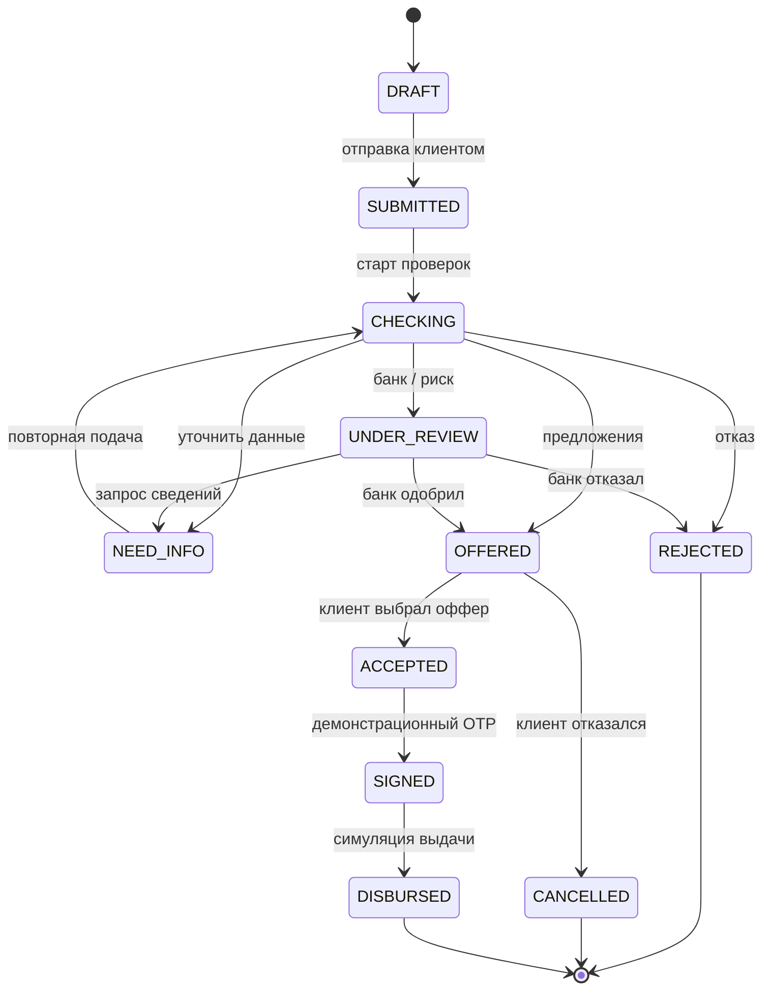

# Машина состояний кредитной заявки

Диаграмма соответствует переходам `alfa.allowed_transitions` из `db/init/001_shema.sql`. Промежуточный `SUBMITTED` может быстро сменяться `CHECKING` внутри процесса подачи.

**Контроль на стороне сервера:** роль, владелец, текущий статус, версия записи, порядок операций, ограничения продукта/DS/залога. Нельзя непосредственно перевести отказанную заявку обратно в `OFFERED`; для нового сценария создаётся новая заявка.

События доступны клиенту через `GET /api/v1/applications/{id}/events`, а в БД — через `alfa.application_events`.

**Прочие исходы:** высокий риск и критическая кредитная история могут приводить к `REJECTED`; неизвестные проверки или просрочки — к ручному рассмотрению; недостаток документов — к `NEED_INFO`; успешное решение может содержать альтернативные предложения. Решение не сводится к простому «да/нет».
